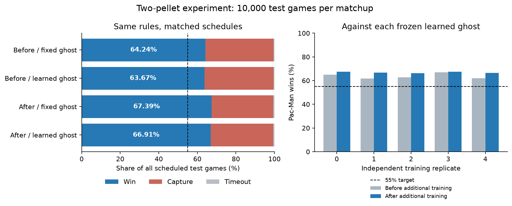

# Two-pellet Pac-Man and a learning search ghost

The goal was to train Q-learning Pac-Man against a ghost that combines limited sight, memory, BFS navigation, and learned search. The target was a 55% Pac-Man win rate, counting every scheduled game.

**The target was exceeded.** Across five independent training runs, final Pac-Man won **6,691 of 10,000 frozen test games, 66.91%**. There were 3,250 captures and 59 timeouts. Each run exceeded 55%, with win rates from 66.30% to 67.55%. The registered validation comparison also exceeded the target, with 6,428 wins in 10,000 games, 64.28%.

These are results for the new two-pellet experiment. They do not replace or reinterpret the historical corner-game results or submitted notebook.



## Results under identical rules

Each row uses five trained policy sets, 1,000 test layout seed slots per set, and two stochastic episode keys per slot. Every scheduled game counts. The evaluator never excludes games using a perfect-play solver.

| Pac-Man | Ghost | Wins | Captures | Timeouts | Win rate |
|---|---|---:|---:|---:|---:|
| Before additional training | Fixed BFS and memory | 6,424 | 3,530 | 46 | 64.24% |
| Before additional training | Learned search | 6,367 | 3,590 | 43 | 63.67% |
| After additional training | Fixed BFS and memory | 6,739 | 3,203 | 58 | 67.39% |
| After additional training | Learned search | 6,691 | 3,250 | 59 | **66.91%** |

Against the same frozen learned ghosts, additional mixed-opponent training raised the aggregate win rate by **3.24 percentage points**. The timeout rate remained below 1%.

| Training replicate | Before additional training, learned ghost | After additional training, learned ghost | Final wins / captures / timeouts |
|---|---:|---:|---|
| 0 | 65.05% | 67.55% | 1,351 / 634 / 15 |
| 1 | 61.70% | 66.70% | 1,334 / 655 / 11 |
| 2 | 62.70% | 66.30% | 1,326 / 661 / 13 |
| 3 | 66.90% | 67.55% | 1,351 / 642 / 7 |
| 4 | 62.00% | 66.45% | 1,329 / 658 / 13 |

The [machine-readable aggregate](hybrid-55/aggregate.json) includes approximate crossed-cluster bootstrap intervals. The bootstrap resamples training replicates and wall-layout hashes independently while preserving repeated games and paired policy comparisons within each cluster. Five training replicates still limit inference about training variability. Ordinary per-report Wilson intervals are labeled as unclustered and should not be treated as accounting for repeated layouts.

The approximate interval for the final win rate is **62.29% to 71.34%**. The paired gain after additional training is **1.32 to 4.93 percentage points** under this bootstrap procedure.

## What the agents know

The maze is 5 by 5. Pac-Man and the ghost start in opposite corners. Exactly two distinct pellets are sampled on open cells, excluding both starting cells. Pac-Man wins by collecting both within 100 turns.

Pac-Man always receives the ghost's current position and the remaining pellet positions. He discovers adjacent walls and remembers them. He does not receive the full wall map. His Q-table uses route hints computed from this remembered map, which can incorrectly treat an undiscovered wall as open.

The ghost knows the static maze for BFS navigation. It sees Pac-Man only along an unobstructed row or column. Its observation contains no hidden Pac-Man coordinates or hidden movement commands. It infers direction only from consecutive visible positions.

After losing sight, the ghost navigates to the last-seen position. It then investigates bounded directional targets. Each target is up to three open cells away, each choice lasts at most four moves, and each sighting permits at most three choices. Memory expires after 12 hidden observations. A new sighting interrupts search; expired or exhausted search returns to seeded random wandering.

## What learns

Pac-Man learns movement decisions with tabular Q-learning. His eight state features describe the first planned step toward a pellet, legal neighboring directions, relative ghost position, estimated ghost distance and sight, remaining pellet count, pellet distance, and time remaining. Final policies contain about 17,700 to 18,100 visited state rows, with four action values per row.

Pac-Man receives a one-time reward of 1 per pellet, 100 for winning, -100 for capture or timeout, and -0.05 per turn. His learning rate is 0.1 and discount is 1.0. Timeouts are terminal, with no bootstrap value. These rewards include route-length and collection preferences, so they do not optimize win probability alone.

The ghost learns which directional target to investigate after a lost sighting. BFS still performs navigation. The fixed ghost prefers the last observed direction when available and otherwise chooses randomly; the learned ghost uses its Q-values. Both share identical knowledge, movement, memory, candidate targets, and budgets. An unseen learned search state uses the fixed rule when all action values are equal.

The ghost receives 1 for capture, -1 if Pac-Man wins, and 0 for timeout. It receives no hidden-distance reward or success reward for preventing a Pac-Man win through timeout. Its learning rate is 0.1 and discount is 0.97. Across the five runs it made 8,665 to 10,277 actual search Q-updates and learned 1,403 to 1,531 state rows.

A search choice can last several turns. Its update accumulates discounted rewards over that duration and discounts the next search decision by the same elapsed number of turns. Capture credit remains available after reacquisition, including when Pac-Man walks into the ghost before its next action. Both learners finalize exactly once at the game boundary.

## Training and evaluation

Each independent run used these fixed budgets:

1. Train a fresh Pac-Man for 30,000 games against the fixed ghost. Save frozen checkpoints at 10,000, 20,000, and 30,000 games.
2. Train a fresh ghost for 30,000 games against that frozen checkpoint pool.
3. Freeze the ghost. Continue the final Pac-Man table for 50,000 games against an equally mixed fixed and learned ghost schedule.

This totals 550,000 training games across all five runs. A policy is a learned state-to-action strategy, not a recorded route. Frozen opponents still react to the current game, but their tables cannot update. Immutable policy snapshots and before/after hashes enforce that separation.

Training layout seed blocks are disjoint across replicates and separate from validation and test layout partitions. Episode streams separately determine pellets, ghost randomness, exploration, and opponent selection. The same evaluation schedules are paired across the policies being compared. All five final policy sets were frozen before the test evaluation. No policy or rule was changed based on test outcomes.

The historical project previously evaluated these test wall-layout partitions under different rules. This is a new ruleset evaluation, not a claim that the underlying layout dataset has never been inspected.

## Interpretation and limitations

The learned ghost made a small descriptive difference. Against final Pac-Man, it captured 3,250 games compared with 3,203 for the fixed ghost, an increase of 0.47 percentage points. This does not establish a large ghost-strength improvement. Learning affects only investigation choices, so its influence is smaller than changing the entire movement controller.

Pac-Man improved after the additional training stage, but that stage changes training budget and opponent mixture together. There is no equal-budget fixed-only control. The results therefore do not isolate a benefit caused specifically by learned-ghost exposure or self-play.

Changing from corner collection to two pellets and restricting the ghost's information also changes difficulty. Those changes cannot be presented as an algorithmic improvement over the historical game. The comparisons above keep the new rules fixed.

Both state encoders compress partially observed situations. Different situations may share Q-values. The experiment demonstrates measured performance under this protocol, not convergence to optimal play or a guarantee of a 55% rate on every new map distribution.

## Run and verify

Use Python with the repository dependencies installed. Example commands use replicate 0; all five policy sets are included in the evidence directory.

```bash
python -m pacman.hybrid watch --pac-policy reports/hybrid-55/replicate-0/pacman.npz --ghost-policy reports/hybrid-55/replicate-0/ghost.npz --seed 1000000 --key 42 --plain
python -m pacman.hybrid evaluate --pac-policy reports/hybrid-55/replicate-0/pacman.npz --ghost-policy reports/hybrid-55/replicate-0/ghost.npz --split val --games 1000 --repeats 2
python scripts/verify_hybrid_run.py reports/hybrid-55/replicate-0 --all
```

To reproduce training in a new directory:

```bash
python -m pacman.hybrid train --out runs/my-hybrid-replicate-0 --replicate 0 --games 1000 --repeats 2
```

The [full rules and implementation contract](../Architecture/hybrid-experiment.md) explains observation boundaries, turn order, rewards, schemas, and evaluation. Versioned numeric artifacts reject legacy policies, mismatched roles, incompatible rules, malformed states, and nonfinite values. Raw evaluation records are compressed without changing their contents.

The complete test suite passes **545 tests**. Verification tooling also includes negative controls for incorrect totals, altered individual games with unchanged outcome counts, missing reports or scheduled games, wrong policies, wrong rules, wrong features, and wrong replicate IDs. Sampled replay explicitly cannot claim complete verification.

Before archival, **all 125,000 saved evaluation games replayed exactly**, including every validation checkpoint, validation cross-play matchup, and frozen test matchup. Each archived run includes its complete verification result. The [source manifest](hybrid-55/source-manifest.json), [pre-test policy freeze](hybrid-55/test-freeze.json), and [file inventory](hybrid-55/sha256.json) identify the implementation, tools, policies, and saved evidence.
